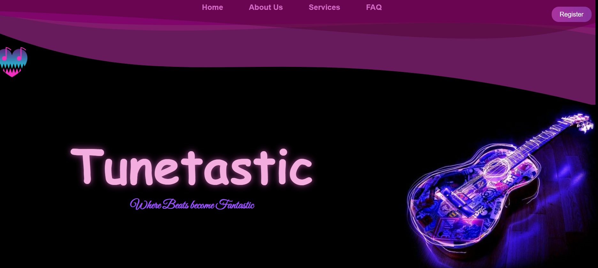
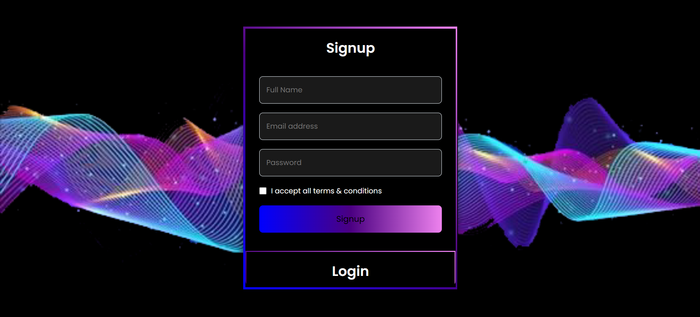

# TuneTastic — Music Platform (Original Student Project)

**TuneTastic** is a music-themed web platform developed as a student project using **HTML, CSS, JavaScript, PHP, and MySQL**. The original application explores music discovery and playback, account registration, artist beat uploads and editing, and a demonstration purchase workflow.

This repository preserves the **original design, code, images, and audio**. It is an educational prototype, **not a production-ready music marketplace**.

## Screenshots

### Homepage

The original black-and-purple landing page, featuring the TuneTastic branding and music-inspired artwork.



### Registration and Login

The original account interface with signup and login forms.



## Project Features

- **Music-themed homepage** with navigation to About Us, Services, FAQ, and registration pages.
- **Music listening pages** with bundled audio tracks and JavaScript-assisted playback interfaces.
- **User registration and login** interfaces connected to PHP processing scripts.
- **Creator features** for submitting and managing beats through PHP endpoints.
- **Purchase-related demonstration** pages designed as part of the coursework (not a real payment solution).
- **Original imagery and audio assets** maintained for the archival version of the project.

Some server-side functionality requires a compatible MySQL database and may need repairs before it can run locally. The features listed above describe code and interfaces present in the archive, not a fully tested deployed service.

## Technology Stack

| Layer | Technologies |
| --- | --- |
| Frontend | HTML, CSS, JavaScript |
| Backend | PHP |
| Data storage | MySQL (used by original PHP scripts) |
| Media | MP3 audio, images, and uploaded-file assets |

## Selected Project Structure

```text
TuneTastic/
├── homepage.html           # Original landing page
├── index.html              # Identical copy of homepage for convenience
├── Registration.html       # Signup and login interfaces
├── aboutus.html            # About page
├── faq.html                # FAQ page
├── listen.html             # Music listening interface
├── produce.html            # Creator / beat submission interface
├── purchase.html           # Purchase-related project page
├── signupprocess.php       # Original signup handler
├── loginprocess.php        # Original login handler
├── process_beat.php        # Original beat-processing code
├── audio/                  # Original bundled audio tracks
├── assets/                 # Original assets
├── uploads/                # Original uploaded media
├── screenshots/
│   ├── tunetastic-homepage.png
│   └── tunetastic-registration.png
├── RESTORE_NOTES.md
└── README.md
```

Additional HTML, PHP, JavaScript, images, and MP3 files from the original project remain in the repository.
